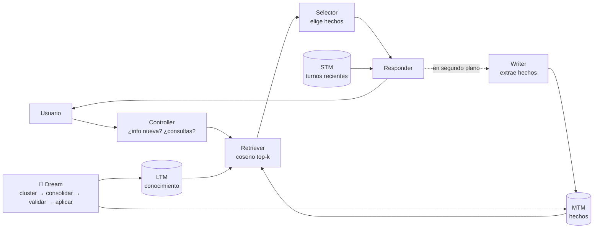

# El agente que sueña

Un agente conversacional con **memoria de tres niveles** y una fase de **"sueño"** (consolidación offline), inspirado en LightMem, del paper *Lightweight LLM Agent Memory with Small Language Models* (Zhang et al., ACL 2026; [arXiv:2604.07798](https://arxiv.org/abs/2604.07798)). Todo corre en local con [Ollama](https://ollama.com) y modelos abiertos: **cero APIs externas, cero API keys**.

El demo deja ver lo que suele quedar oculto: qué decidió cada módulo en cada turno (la traza), qué hay en cada nivel de memoria y qué cambió el Dream (fusiones, actualizaciones, promociones y olvidos, con un diff). Además trae un selector para responder con **LightMem**, con un **RAG ingenuo** o **con ambos lado a lado**, porque el resultado principal del benchmark es que el RAG ingenuo gana (ver [Resultados](#resultados)).

> No es una reproducción del paper: usa modelos locales sin fine-tuning y ningún modelo grande de API. Las divergencias están en [`docs/paper-notes.md`](docs/paper-notes.md).

## Arquitectura



**Online (cada turno).**
1. El **Controller** decide si el mensaje trae información nueva y escribe las consultas de búsqueda.
2. El **Retriever** busca por coseno sobre MTM y LTM.
3. El **Selector** se queda con los hechos relevantes.
4. El **Responder** contesta con esos hechos más los últimos turnos (STM).
5. Después de responder, el **Writer** extrae hechos atómicos del mensaje del usuario y los guarda en MTM. Si un hecho ya existe (coseno ≥ 0.95), lo refuerza en vez de duplicarlo.

**Offline (Dream).**
1. Agrupa las entradas por similitud, temas o entidades compartidas.
2. Un LLM propone operaciones: `MERGE`, `UPDATE`, `PROMOTE` (MTM → LTM) y `FORGET`.
3. Un **validador determinista** las filtra. Rechaza:
   - nombres o números que no están en las entradas originales;
   - UPDATE que pierden el valor vigente;
   - FORGET sobre LTM o sobre temas protegidos (salud, familia, trabajo…);
   - PROMOTE sin evidencia suficiente.
4. Lo aprobado se aplica en una sola transacción, con soft-delete y trazabilidad (`superseded_by`).

**RAG ingenuo (para comparar).** Cada frase del usuario se guarda literal con su embedding; las 8 más parecidas van directo al Responder. Una sola llamada al LLM, sin reescribir nada.

| Pieza | Implementación |
|---|---|
| API y UI | FastAPI + HTML/JS sin dependencias (`app/static/index.html`) |
| LLM | Ollama, `qwen2.5:3b-instruct` por defecto en el contenedor (en el benchmark, 7B y 3B) |
| Embeddings | `bge-m3` (multilingüe; las conversaciones mezclan español e inglés) |
| Salida estructurada | JSON Schema generado desde Pydantic en el `format` de Ollama, con validación, 1 reintento y fallback determinista por módulo |
| Memoria | SQLite con embeddings float32 en BLOB y búsqueda por fuerza bruta (numpy) |
| Prompts | `app/prompts/*.md`, versionados; su hash aparece en la traza |

## Prerrequisitos

- **Con Docker** (recomendado): Docker con Compose v2. Unos 8 GB de disco: la imagen de Ollama con los modelos ocupa 7.3 GB (la base `ollama/ollama` incluye librerías de CUDA) y la de la app, 260 MB.
- **Sin Docker**: Python 3.11+, [uv](https://docs.astral.sh/uv/) y Ollama, con `ollama pull qwen2.5:3b-instruct` y `ollama pull bge-m3`.

## Build y run

### Docker Compose

```bash
docker compose up -d --build     # la primera vez descarga los modelos dentro de la imagen
open http://localhost:8080
```

Son dos contenedores:

- `ollama`: con los modelos horneados en la imagen, así que no descarga nada al arrancar y funciona offline.
- `app`: el único puerto expuesto, 8080.

Los límites de `docker-compose.yml` (Ollama con 4 vCPU y 5 GB, sin GPU) imitan un servidor modesto. Latencia medida con el 3B en ese límite: una respuesta de LightMem tarda ~30 s, más ~50 s del Writer en segundo plano; con 2 vCPU, ~75 s. Para una máquina más chica o para usar otro modelo:

```bash
OLLAMA_CPUS=2 LLM_NUM_THREAD=2 docker compose up -d
LLM_MODEL=qwen2.5:1.5b-instruct docker compose up -d --build   # ~2x más rápido, peor memoria
```

### Imágenes sueltas

```bash
docker build -t dreaming-agent-ollama -f Dockerfile.ollama .
docker build -t dreaming-agent-app .
docker network create dreaming
docker run -d --name ollama --network dreaming --cpus 4 -m 5g dreaming-agent-ollama
docker run -d --name app --network dreaming -p 8080:8080 \
  -e OLLAMA_URL=http://ollama:11434 -e LLM_NUM_THREAD=4 dreaming-agent-app
```

### Local, sin Docker (desarrollo)

```bash
uv sync
LLM_MODEL=qwen2.5:3b-instruct uv run uvicorn app.main:app --port 8080
uv run pytest            # tests sin Ollama (LLM y embeddings simulados)
```

La app no tiene autenticación ni TLS: está diseñada para correr detrás de un reverse proxy o gateway que termine TLS y haga la autenticación. La memoria vive en un SQLite **efímero** dentro del contenedor (`/tmp`): cada arranque empieza con la memoria vacía.

## Variables de entorno

| Variable | Por defecto (imagen) | Qué hace |
|---|---|---|
| `OLLAMA_URL` | `http://localhost:11434` | Servidor de Ollama |
| `LLM_MODEL` | `qwen2.5:3b-instruct` | Modelo de todos los módulos (debe estar en Ollama) |
| `EMBED_MODEL` | `bge-m3` | Modelo de embeddings |
| `LLM_NUM_THREAD` | `2` (compose: `4`) | Hilos de inferencia. **Igual a las CPUs del contenedor de Ollama** (ver abajo); `0` = el valor por defecto de Ollama |
| `LLM_TIMEOUT_S` | `180` | Tiempo máximo por llamada al LLM antes del fallback |
| `DB_PATH` | `/tmp/dreaming-agent/memory.db` | SQLite de la memoria |
| `STM_TURNS` / `TOP_K` | `6` / `8` | Turnos de la STM / candidatos por búsqueda |
| `RETRIEVAL_MODE` | `always` | `controller`: solo busca si el Controller lo pide (v1) |
| `SELECTOR_MODE` | `filter` | `compress`: el Responder recibe el resumen del Selector (v1) |
| `WRITER_GROUNDING` | `true` | Descarta hechos con nombres o números ausentes del mensaje |
| `CLUSTER_THRESHOLD` | `0.75` | Coseno mínimo para agrupar en el Dream |
| `PROTECT_FROM_FORGET` | `true` | El Dream solo olvida eventos puntuales sin temas protegidos |

Todas están en [`app/config.py`](app/config.py), comentadas.

> **`LLM_NUM_THREAD` importa mucho.** Dentro de un contenedor con límite de CPU, Ollama ve todos los núcleos del host y lanza un hilo por núcleo; el límite de CPU los estrangula a todos. Con 2 CPUs y 10 hilos, una llamada que debería tardar 4 s tarda **90 s**. Fijar los hilos al límite real lo resuelve.

## Uso

1. Cuéntale cosas sobre ti en varios turnos: dónde vives, tu trabajo, tu mascota… La pestaña **MTM** se llena con los hechos que extrae el Writer (aparecen unos segundos después de la respuesta, marcados "aprendiendo…").
2. Pregúntale algo. Despliega **ver traza** para ver qué buscó el Controller, qué eligió el Selector, qué escribió el Writer y cuánto tardó cada etapa.
3. Cambia algo ("me mudé a…") y pulsa **🌙 Dream**. La pestaña **Sueños** muestra el diff:
   - en verde, lo creado;
   - tachado en rojo, lo reemplazado u olvidado;
   - en amarillo, lo que se fusionó o actualizó (con los originales colapsados);
   - aparte, las propuestas que rechazó el validador y por qué.
4. **Nueva sesión** vacía la STM y conserva MTM y LTM: así se prueba la memoria entre sesiones.
5. Con el selector **LightMem / RAG / Comparar** se ve la misma pregunta respondida con cada memoria. En modo RAG la traza muestra las frases recuperadas.

### API

| Endpoint | Descripción |
|---|---|
| `POST /chat` | `{session_id, message, mode: "lightmem"\|"rag"\|"compare"}` → `{reply, trace, learn_id, rag?}`. El Writer corre después, en segundo plano |
| `GET /learned/{learn_id}` | Resultado del Writer de ese turno (`done: false` mientras corre) |
| `POST /dream` | Ejecuta un Dream; devuelve el diff |
| `GET /dreams` · `GET /memory` | Historial de sueños · contenido de STM/MTM/LTM |
| `POST /session/new` · `POST /reset` | Nueva sesión · borrar toda la memoria |
| `GET /health` · `GET /models` · `POST /model` | Estado de Ollama · modelos disponibles · cambiar de modelo |

## Resultados

Benchmark propio: 1 usuario ficticio, 8 sesiones (45 turnos ES/EN con paráfrasis, cambios y ruido), 28 preguntas en sesiones nuevas y 3 corridas por condición. Detalle en [`docs/RESULTS.md`](docs/RESULTS.md) y [`bench/README.md`](bench/README.md).

| Condición | 7B | 3B |
|---|---|---|
| A — sin memoria (solo STM) | 18 % | 18 % |
| **B — RAG ingenuo** | **88 %** | **93 %** |
| C — pipeline LightMem | 79 % | 58 % |
| D — LightMem + Dream por sesión | 79 ± 9 % | 49 ± 7 % |

Con modelos locales pequeños y sin fine-tuning, **la mejor memoria es la que menos reescribe**. Cada etapa que reescribe un hecho (el Writer, el Dream) es una oportunidad de perderlo o corromperlo, y la consolidación vuelve permanentes esos errores. Algunos ejemplos reales:

- "Te llamas Kiwi": Kiwi es el loro.
- "Vive en Pagora": Pagora es la empresa.
- El olvido de una alergia.

El modelo pequeño **lee bien y escribe mal**: con 3B, el RAG ingenuo es la mejor configuración del estudio, y el pipeline la peor.

```bash
uv run python -m bench.run --condition all --model qwen2.5:3b-instruct --runs 3
```

## Limitaciones

- **No evalúa el paper.** El paper afina el Selector con LoRA y responde con GPT-4o-mini; aquí todo es un modelo local de 3–7B sin fine-tuning. Lo que se mide es si la arquitectura ayuda a un modelo pequeño sin las piezas grandes.
- **Un solo usuario y un solo idioma mixto**, con 28 preguntas: es un estudio de caso, no un benchmark general. El scoring es por palabras clave, revisado a mano.
- **Lento en CPU.** Un turno de LightMem hace 2–3 llamadas al LLM antes de responder, más el Writer después, y en CPU el 3B genera pocos tokens por segundo: ~30 s por respuesta con 4 vCPU (~75 s con 2); un Dream, bastante más. El RAG ingenuo, con una sola llamada, tarda una fracción. Con GPU (Apple M1 Pro) la misma respuesta de LightMem tarda ~5 s.
- **Sin determinismo completo**, aun con temperatura 0 y seed fijo: el Dream varía entre corridas (71–89 % con 7B).
- El validador del Dream comprueba la **forma** (nombres inventados, valores perdidos), **no la verdad**: no evita que el modelo mezcle hechos reales.
- La memoria es de un solo usuario, efímera y no está pensada para datos personales reales.

## Estructura

```
app/            FastAPI, pipeline online (pipeline/), memoria (memory/), Dream (dream/), prompts, UI
bench/          sesiones, preguntas, scoring y runner del benchmark; results/summary.*
docs/           RESULTS.md (resultados), paper-notes.md (notas del paper y divergencias)
scripts/        smoke test de Ollama, conversación y Dream de ejemplo
tests/          pytest (sin Ollama)
LOG.md          bitácora: decisiones, desafíos y hallazgos
```

## Cita

Si usas este trabajo, cita el paper original (entrada oficial de arXiv; cámbiala por la de las actas de ACL cuando se publiquen):

```bibtex
@misc{zhang2026lightweightllmagentmemory,
  title         = {Lightweight LLM Agent Memory with Small Language Models},
  author        = {Jiaquan Zhang and Chaoning Zhang and Shuxu Chen and Zhenzhen Huang and
                   Pengcheng Zheng and Zhicheng Wang and Ping Guo and Fan Mo and Sung-Ho Bae and
                   Jie Zou and Jiwei Wei and Yang Yang},
  year          = {2026},
  eprint        = {2604.07798},
  archivePrefix = {arXiv},
  primaryClass  = {cs.AI},
  url           = {https://arxiv.org/abs/2604.07798},
  note          = {Accepted at ACL 2026 (main conference)}
}
```

Este repositorio es una implementación independiente; no está afiliado con los autores del paper.

## Licencia

El código está bajo la licencia [MIT](LICENSE). Los modelos que la imagen de Ollama descarga tienen sus propias licencias, distintas de la del código: revisa la de cada modelo antes de redistribuir la imagen o usarla con fines comerciales (por ejemplo, `qwen2.5:3b-instruct` se publica bajo la *Qwen Research License*, y `bge-m3` bajo MIT).
